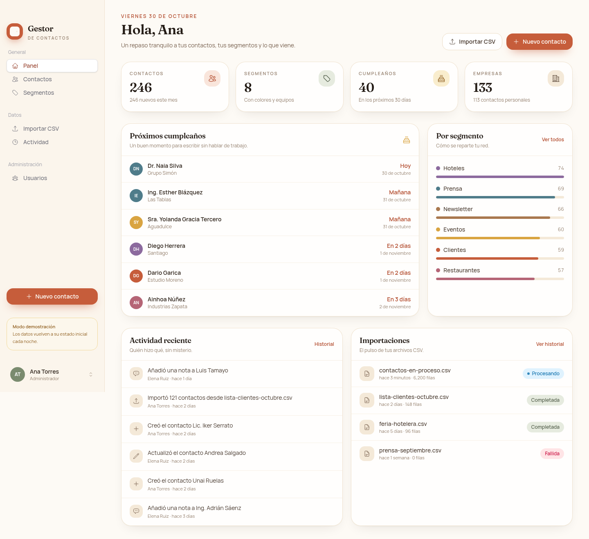
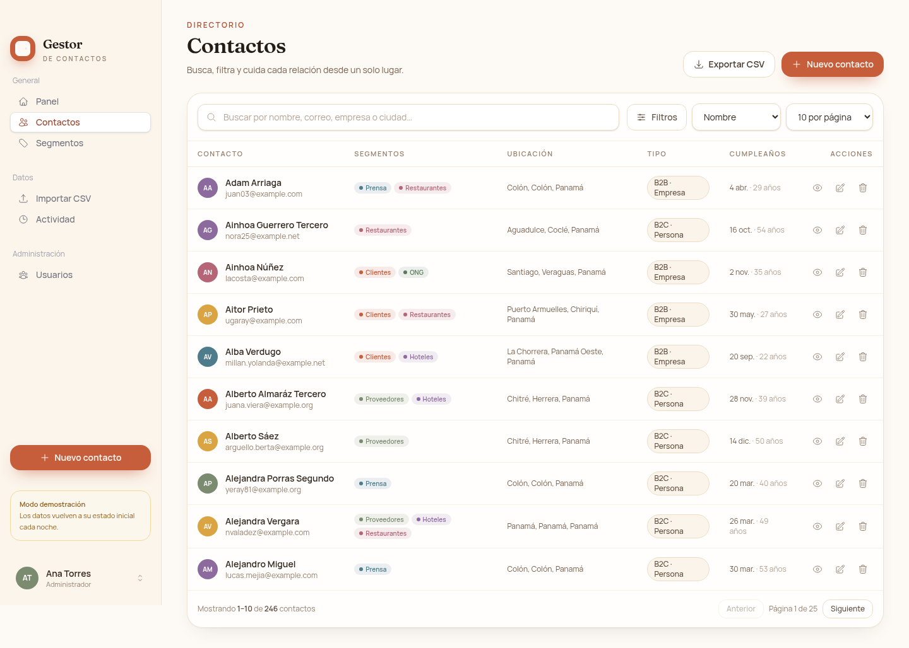
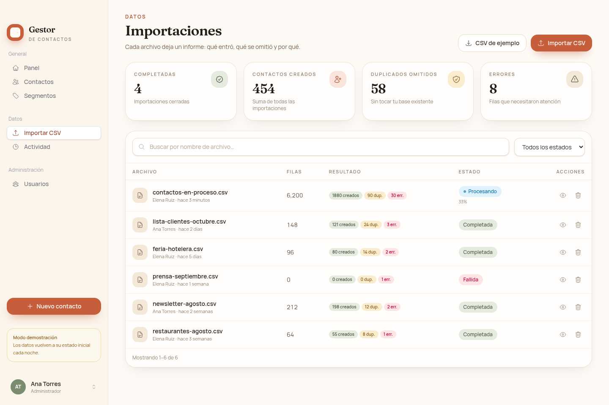
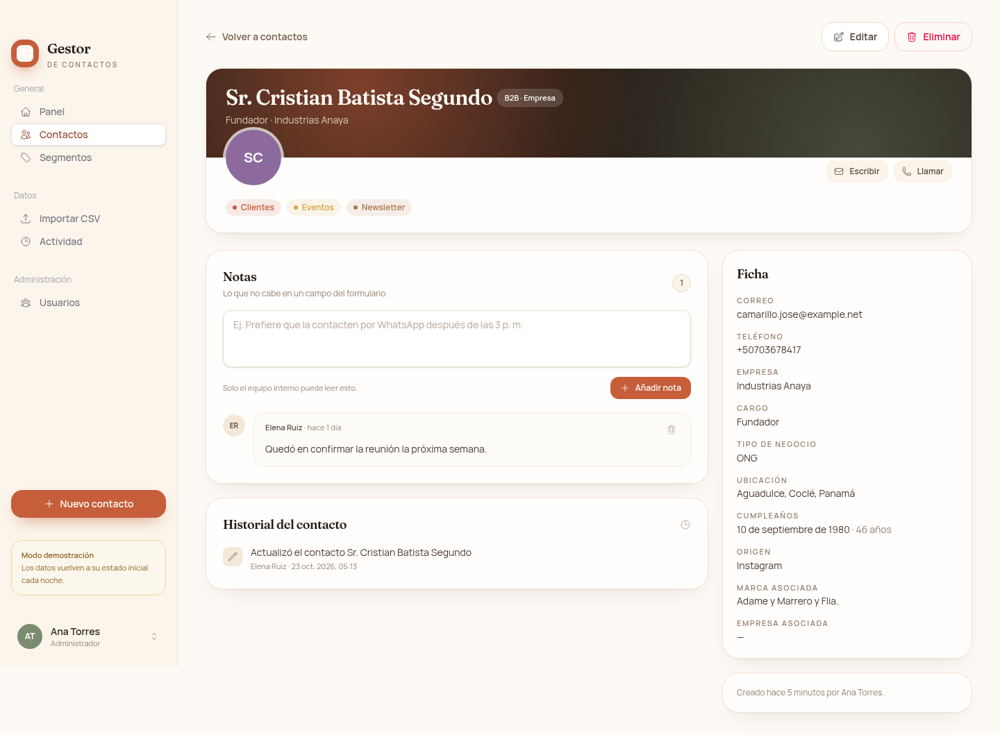
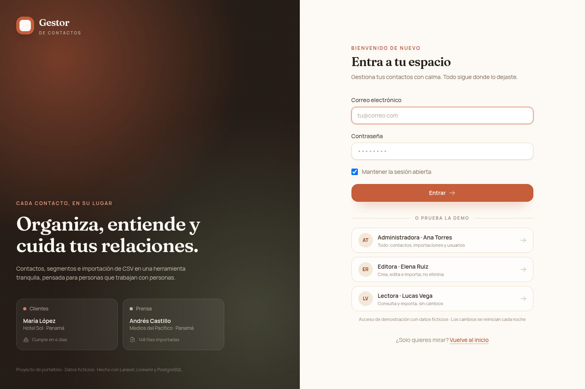

<a id="espanol"></a>

# Gestor de contactos

**Un lugar cálido para tus contactos**, construido con Laravel, Livewire y PostgreSQL. Reúne personas, empresas, segmentos con color, notas e importaciones CSV en un espacio pensado para trabajar con calma.

Este proyecto está inspirado en un ejercicio de mi práctica profesional; fue reconstruido desde cero con diseño propio y datos ficticios.

[Read this in English](#english)

- **Demo estática, sin backend:** [zobercito.github.io/gestor-de-contactos](https://zobercito.github.io/gestor-de-contactos/) — datos simulados en el navegador.
- **Aplicación completa:** Laravel 12 + Livewire + PostgreSQL, lista para ejecutarse con Docker.

## Capturas

| Panel | Contactos |
| --- | --- |
|  |  |

| Importaciones CSV | Ficha de contacto |
| --- | --- |
|  |  |



## Funcionalidades

- **Panel:** total de contactos, segmentos, empresas y cumpleaños de los próximos 30 días; distribución por segmento; actividad reciente e importaciones.
- **Contactos:** alta, edición, borrado y ficha detallada. Búsqueda por nombre, correo, teléfono, empresa o ciudad; filtros por segmento, tipo, género, ciudad, provincia, país, tipo de negocio, origen y mes de cumpleaños; orden y paginación (10/25/50).
- **Segmentos:** agrupaciones con color propio, descripción y CRUD completo.
- **Importación CSV:** archivo de ejemplo, vista previa, mapeo automático o manual de columnas, detección de duplicados por correo o teléfono, informe de filas creadas, omitidas y con error. Los archivos de hasta 5 000 filas se procesan al momento; los más grandes pasan a la cola con progreso en vivo.
- **Exportación CSV:** respeta los filtros activos, incluye BOM UTF-8 y escapa valores que podrían interpretarse como fórmulas en una hoja de cálculo.
- **Notas e historial:** notas internas por contacto y registro de actividad de la cuenta.
- **Roles y permisos:** administración, edición y lectura, con políticas aplicadas en el servidor.
- **Ajustes:** perfil, contraseña y apariencia clara/oscura.
- **Modo demostración:** acceso de un clic con tres perfiles, límites de importación y reinicio nocturno programado.

### Roles

| Rol | Contactos | Segmentos | Importaciones | Usuarios |
| --- | --- | --- | --- | --- |
| Administrador | Crear, editar, eliminar | Crear, editar, eliminar | Importar, eliminar | Gestionar |
| Editor | Crear, editar | Crear, editar | Importar | — |
| Lector | Consultar y exportar | Consultar | Consultar | — |

## Stack

- PHP 8.4 · Laravel 12
- Livewire 3 con componentes Volt · Flux 2
- Tailwind CSS 4 · Vite 6
- PostgreSQL 17
- Pest 3 · Larastan · Pint
- Docker Compose con servicios `app`, `nginx`, `postgres`, `queue`, `scheduler` e `init`
- GitHub Actions para pruebas, análisis estático y despliegue de la demo

## Puesta en marcha con Docker

Requisitos: Docker con Compose y Node.js 22+ para compilar los assets.

```bash
git clone https://github.com/Zobercito/gestor-de-contactos.git
cd gestor-de-contactos

cp .env.example .env
docker compose run --rm --no-deps app php artisan key:generate
npm ci
npm run build
docker compose up -d --build
```

Abre <http://localhost:8080>. El servicio `init` instala las dependencias de PHP, ejecuta las migraciones y siembra datos ficticios. Los servicios de cola y scheduler quedan activos.

### Cuentas de demostración

Activa el modo demostración en `.env` con `DEMO_MODE=true` para ver el acceso de un clic en la pantalla de entrada. También puedes iniciar sesión con estas cuentas:

| Perfil | Correo | Contraseña |
| --- | --- | --- |
| Administradora | `admin@gestordecontactos.test` | `demo1234` |
| Editora | `editor@gestordecontactos.test` | `demo1234` |
| Lectora | `lector@gestordecontactos.test` | `demo1234` |

Con `DEMO_MODE=true`, el scheduler reinicia la base cada noche a la hora indicada en `DEMO_RESET_AT` (03:00 por defecto). Para hacerlo a mano:

```bash
docker compose exec app php artisan demo:reset --force
```

### Comandos útiles

```bash
docker compose logs -f app queue scheduler   # registros
docker compose exec app php artisan migrate   # migraciones
docker compose exec app php artisan demo:reset --force
docker compose down                           # detener
docker compose down -v                        # detener y borrar la base
```

### Sin Docker

Requiere PHP 8.2+, Composer, PostgreSQL y Node.js 22+.

```bash
composer install
cp .env.example .env
php artisan key:generate
# Ajusta DB_* en .env a tu instancia de PostgreSQL
php artisan migrate --seed
npm install
npm run build
php artisan serve
```

Para procesar importaciones grandes y el reinicio nocturno, ejecuta también `php artisan queue:work` y `php artisan schedule:work`.

## Demo estática

La carpeta [`demo/`](demo) contiene una maqueta funcional sin backend: sesión, contactos, segmentos, notas, importaciones y exportación viven en `localStorage`, y el CSV se procesa en el navegador. Sirve para recorrer la interfaz completa sin instalar nada.

```bash
cd demo
python3 -m http.server 8123
# http://127.0.0.1:8123
```

No abras `index.html` con `file://`. El flujo [`.github/workflows/pages.yml`](.github/workflows/pages.yml) publica `demo/` en GitHub Pages al hacer push a `main`; solo hay que elegir **GitHub Actions** como origen en **Settings → Pages**.

## Pruebas y calidad

```bash
docker compose exec app php artisan test
docker compose exec app vendor/bin/pint --test
docker compose exec app vendor/bin/phpstan analyse
```

La suite usa SQLite en memoria; la aplicación usa PostgreSQL. El flujo de CI ejecuta pruebas, Pint y Larastan en cada push y pull request.

## Estructura

```
app/                Modelos, componentes Livewire, políticas, servicios y job de importación
database/           Migraciones, factories, seeders y CSV de ejemplo
demo/               Demo estática (HTML, CSS y JavaScript, sin backend)
docker/             Imagen PHP, entrypoint y configuración de nginx
docs/screenshots/   Capturas para el README
resources/          Vistas Blade, estilos y configuración de Vite
routes/             Rutas web y programación de tareas
tests/              Pruebas de feature y unitarias con Pest
```

## Despliegue

La aplicación está pensada para ejecutarse en cualquier host con Docker Compose:

1. Configura `APP_ENV=production`, `APP_DEBUG=false`, `APP_URL` y una contraseña de base de datos segura.
2. Compila los assets con `npm ci && npm run build`.
3. Levanta los servicios con `docker compose up -d --build`.
4. Termina TLS en un proxy inverso (Caddy, nginx o Traefik) delante del puerto 8080.
5. Mantén activos los servicios `queue` y `scheduler`, o sus equivalentes gestionados.

En plataformas como Render o Railway se puede desplegar el `Dockerfile`, usar su PostgreSQL gestionado y ejecutar `php artisan migrate --seed` como comando de release. Conviene elegir una instancia que no se suspenda por inactividad y procesos persistentes para la cola y el scheduler.

## Contexto y datos

- Todos los contactos, empresas, correos y marcas son ficticios y se generan con Faker o con datos de ejemplo del repositorio.
- El proyecto no incluye datos, marcas ni código propietario de ninguna empresa.
- La interfaz y la identidad visual fueron diseñadas para este proyecto.

## Licencia

[MIT](LICENSE) © 2026 Zobercito

---

<a id="english"></a>

# Gestor de contactos

**A warm, straightforward contact manager** built with Laravel, Livewire and PostgreSQL. It brings people, companies, colour-coded segments, notes and CSV imports together in a calm workspace.

Inspired by an exercise from my professional practice; rebuilt from scratch with an original design and fictional data.

[Leer en español](#espanol)

- **Static demo, no backend:** [zobercito.github.io/gestor-de-contactos](https://zobercito.github.io/gestor-de-contactos/) — simulated data in the browser.
- **Full application:** Laravel 12 + Livewire + PostgreSQL, ready to run with Docker.

## Features

- **Dashboard:** totals for contacts, segments and companies, plus birthdays in the next 30 days, segment distribution, recent activity and imports.
- **Contacts:** create, edit, delete and view a detailed record. Search by name, email, phone, company or city; filter by segment, type, gender, city, province, country, business type, source and birth month; sort and paginate (10/25/50).
- **Segments:** colour-coded groups with descriptions and full CRUD.
- **CSV import:** sample file, preview, automatic or manual column mapping, duplicate detection by email or phone, and a per-row report of created, skipped and failed rows. Files up to 5,000 rows run immediately; larger files are queued with live progress.
- **CSV export:** respects active filters, writes a UTF-8 BOM and escapes values that spreadsheet apps could interpret as formulas.
- **Notes and history:** internal notes per contact and an account activity log.
- **Roles and permissions:** admin, editor and viewer, enforced by server-side policies.
- **Settings:** profile, password and light/dark appearance.
- **Demo mode:** one-click access for three profiles, import limits and a scheduled nightly reset.

### Roles

| Role | Contacts | Segments | Imports | Users |
| --- | --- | --- | --- | --- |
| Admin | Create, edit, delete | Create, edit, delete | Import, delete | Manage |
| Editor | Create, edit | Create, edit | Import | — |
| Viewer | View and export | View | View | — |

## Stack

- PHP 8.4 · Laravel 12
- Livewire 3 with Volt components · Flux 2
- Tailwind CSS 4 · Vite 6
- PostgreSQL 17
- Pest 3 · Larastan · Pint
- Docker Compose services: `app`, `nginx`, `postgres`, `queue`, `scheduler`, `init`
- GitHub Actions for tests, static analysis and demo deployment

## Getting started with Docker

Requirements: Docker with Compose and Node.js 22+ to build the assets.

```bash
git clone https://github.com/Zobercito/gestor-de-contactos.git
cd gestor-de-contactos

cp .env.example .env
docker compose run --rm --no-deps app php artisan key:generate
npm ci
npm run build
docker compose up -d --build
```

Open <http://localhost:8080>. The `init` service installs PHP dependencies, runs migrations and seeds fictional data. The queue and scheduler services stay active.

### Demo accounts

Set `DEMO_MODE=true` in `.env` to show the one-click demo entry on the sign-in screen. You can also sign in with:

| Profile | Email | Password |
| --- | --- | --- |
| Admin | `admin@gestordecontactos.test` | `demo1234` |
| Editor | `editor@gestordecontactos.test` | `demo1234` |
| Viewer | `lector@gestordecontactos.test` | `demo1234` |

With `DEMO_MODE=true`, the scheduler resets the database nightly at `DEMO_RESET_AT` (03:00 by default). To run it manually:

```bash
docker compose exec app php artisan demo:reset --force
```

### Useful commands

```bash
docker compose logs -f app queue scheduler   # logs
docker compose exec app php artisan migrate   # migrations
docker compose exec app php artisan demo:reset --force
docker compose down                           # stop
docker compose down -v                        # stop and remove the database
```

### Without Docker

Requires PHP 8.2+, Composer, PostgreSQL and Node.js 22+.

```bash
composer install
cp .env.example .env
php artisan key:generate
# Point DB_* in .env to your PostgreSQL instance
php artisan migrate --seed
npm install
npm run build
php artisan serve
```

For large imports and the nightly reset, also run `php artisan queue:work` and `php artisan schedule:work`.

## Static demo

The [`demo/`](demo) folder contains a functional front-end mockup with no backend: session, contacts, segments, notes, imports and exports live in `localStorage`, and CSV files are processed in the browser. It lets you explore the full interface without installing anything.

```bash
cd demo
python3 -m http.server 8123
# http://127.0.0.1:8123
```

Do not open `index.html` through `file://`. The [`.github/workflows/pages.yml`](.github/workflows/pages.yml) workflow publishes `demo/` to GitHub Pages on pushes to `main`; select **GitHub Actions** as the source under **Settings → Pages**.

## Tests and quality

```bash
docker compose exec app php artisan test
docker compose exec app vendor/bin/pint --test
docker compose exec app vendor/bin/phpstan analyse
```

The test suite uses in-memory SQLite; the application runs on PostgreSQL. CI runs tests, Pint and Larastan on every push and pull request.

## Project layout

```
app/                Models, Livewire components, policies, services and import job
database/           Migrations, factories, seeders and sample CSV
demo/               Static demo (HTML, CSS and JavaScript, no backend)
docker/             PHP image, entrypoint and nginx configuration
docs/screenshots/   README screenshots
resources/          Blade views, styles and Vite configuration
routes/             Web routes and scheduled tasks
tests/              Feature and unit tests with Pest
```

## Deployment

The application is designed to run on any host with Docker Compose:

1. Set `APP_ENV=production`, `APP_DEBUG=false`, `APP_URL` and a strong database password.
2. Build assets with `npm ci && npm run build`.
3. Start the services with `docker compose up -d --build`.
4. Terminate TLS at a reverse proxy (Caddy, nginx or Traefik) in front of port 8080.
5. Keep the `queue` and `scheduler` services running, or their managed equivalents.

Platforms such as Render or Railway can deploy the `Dockerfile`, use their managed PostgreSQL and run `php artisan migrate --seed` as a release command. Choose an instance that does not sleep when idle, with persistent processes for the queue and scheduler.

## Context and data

- Every contact, company, email address and brand is fictional, generated with Faker or taken from the repository's sample data.
- The project contains no proprietary data, brands or code from any company.
- The interface and visual identity were designed for this project.

## License

[MIT](LICENSE) © 2026 Zobercito
